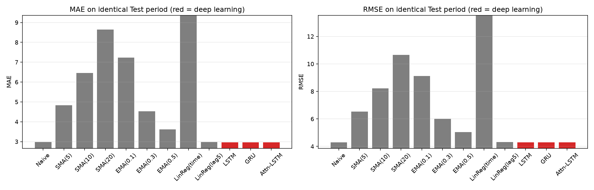
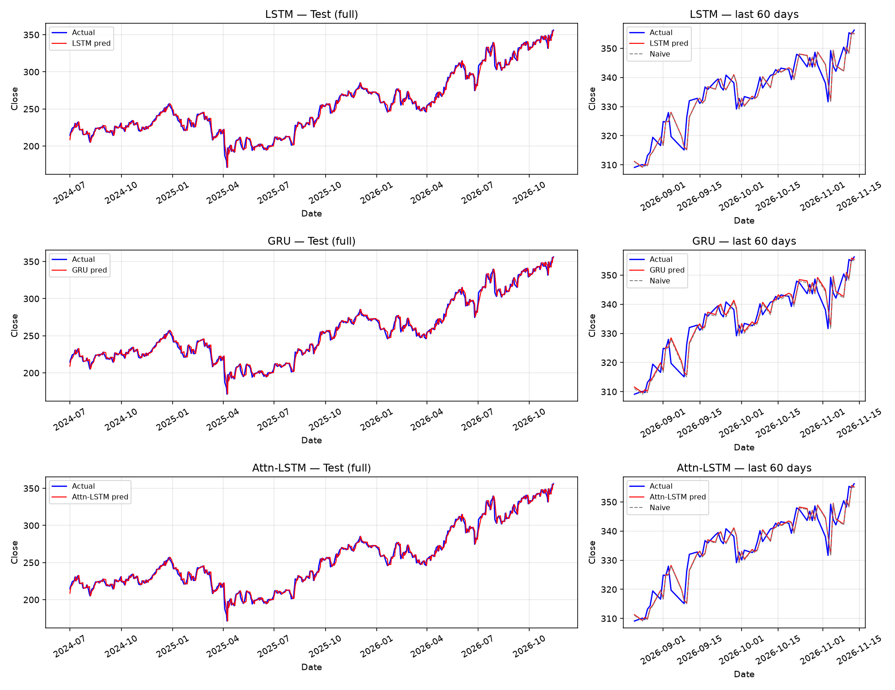

# 베이스라인 비교 리포트 — AAPL (자동 생성)

- Test 구간: 2024-07-01 ~ 2026-11-13 (597) · 모든 모델 동일 Test 시점 597개에서 평가
- 베이스라인은 딥러닝 학습 전에 먼저 측정됨 (`outputs/track_b/baseline_results.csv`의 measured_at)
- 딥러닝 지표는 seed 3개 평균 (std는 `all_results.csv`). 설정: `{'lookback': 30, 'hidden': 64, 'layers': 2, 'dropout': 0.2, 'lr': 0.001, 'weight_decay': 1e-05, 'batch_size': 64, 'epochs': 100, 'patience': 12}`

## 1. 성능 비교표

| Model        |     MAE |    RMSE |   MAPE(%) | type     |
|:-------------|--------:|--------:|----------:|:---------|
| Naive        |  2.9713 |  4.2958 |    1.1863 | baseline |
| SMA(5)       |  4.8285 |  6.5415 |    1.9449 | baseline |
| SMA(10)      |  6.4568 |  8.2165 |    2.5826 | baseline |
| SMA(20)      |  8.6438 | 10.6589 |    3.4095 | baseline |
| EMA(0.1)     |  7.2371 |  9.1192 |    2.8601 | baseline |
| EMA(0.3)     |  4.5292 |  6.0133 |    1.8177 | baseline |
| EMA(0.5)     |  3.6098 |  5.0363 |    1.4506 | baseline |
| LinReg(time) | 54.8521 | 63.2215 |   20.2332 | baseline |
| LinReg(lag5) |  2.9753 |  4.3081 |    1.1895 | baseline |
| LSTM         |  2.9588 |  4.2909 |    1.1821 | deep     |
| GRU          |  2.9676 |  4.2983 |    1.1857 | deep     |
| Attn-LSTM    |  2.959  |  4.2905 |    1.1818 | deep     |

## 2. 개선율 (양수 = 딥러닝이 우수) & Diebold-Mariano 검정

개선율 = (베이스라인 오차 − 딥러닝 오차) / 베이스라인 오차 × 100. DM p-value < 0.05 일 때만 '통계적으로 유의한 차이'.

| Deep model   | vs    |   MAE 개선(%) |   RMSE 개선(%) |   MAPE(%) 개선(%) |   DM stat |   p-value |
|:-------------|:------|------------:|-------------:|----------------:|----------:|----------:|
| LSTM         | Naive |      0.4204 |       0.1141 |          0.3562 |   -0.8741 |    0.3821 |
| GRU          | Naive |      0.1235 |      -0.0581 |          0.0523 |    0.1123 |    0.9106 |
| Attn-LSTM    | Naive |      0.4138 |       0.1215 |          0.3803 |   -0.6446 |    0.5192 |

