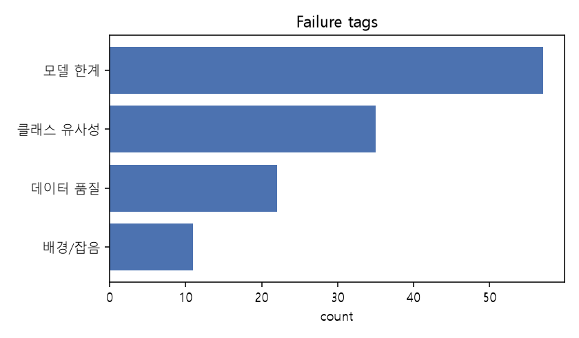
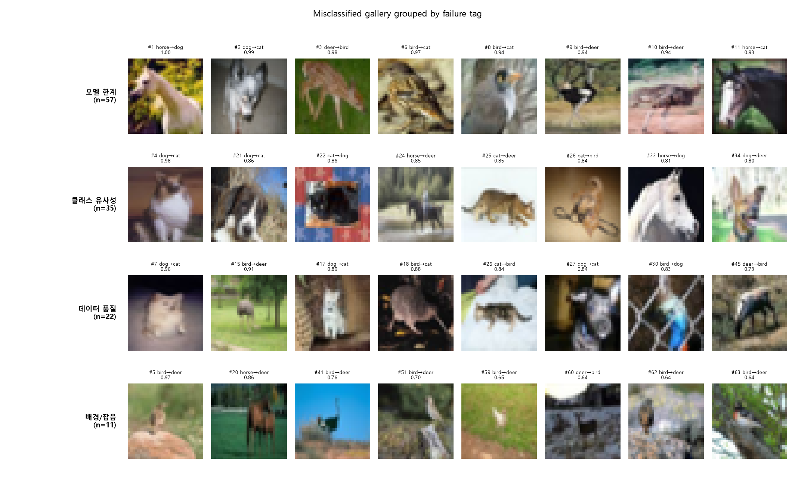

# 오차 분석표 (Error Analysis Table)

- 분석 대상 Run: `outputs\track_a\partial`  |  오분류 125건 (최소 기준 30건 충족)
- 원본 표: `reports\error_analysis_table.csv` (사람이 태깅한 CSV)

## 1. 태그 통계

| tag     |   count |   ratio(%) |   mean_conf | 개선 방향                                             |
|:--------|--------:|-----------:|------------:|:--------------------------------------------------|
| 모델 한계   |      57 |       45.6 |       0.673 | 모델 구조 변경 (더 큰 Backbone, Attention/ViT)            |
| 클래스 유사성 |      35 |       28   |       0.614 | 특징 학습 강화 (Fine-tuning 범위↑, 고해상도, Metric learning) |
| 데이터 품질  |      22 |       17.6 |       0.662 | 데이터 증강 (밝기/대비/블러/해상도)                             |
| 배경/잡음   |      11 |        8.8 |       0.655 | 배경 제거·Crop/RandomErasing 증강                       |

## 2. 자주 틀리는 클래스 쌍 (실제 → 예측)

| pair         |   count |
|:-------------|--------:|
| dog → cat    |      19 |
| bird → deer  |      15 |
| deer → bird  |      12 |
| cat → dog    |      12 |
| bird → cat   |       9 |
| cat → bird   |       9 |
| deer → cat   |       9 |
| horse → cat  |       7 |
| bird → dog   |       6 |
| horse → deer |       5 |

## 3. 태그별 오분류 갤러리

## 4. 전체 오차 분석표

|   번호 | 파일명             | 실제/예측        |   신뢰도 | 실패 원인 태그   | 세부   | 메모   |
|-----:|:----------------|:-------------|------:|:-----------|:-----|:-----|
|    1 | img_te07722.png | horse → dog  | 0.998 | 모델 한계      |      |      |
|    2 | img_te08794.png | dog → cat    | 0.994 | 모델 한계      |      |      |
|    3 | img_te06243.png | deer → bird  | 0.984 | 모델 한계      |      |      |
|    4 | img_te05426.png | dog → cat    | 0.982 | 클래스 유사성    |      |      |
|    5 | img_te02033.png | bird → deer  | 0.974 | 배경/잡음      |      |      |
|    6 | img_te04163.png | bird → cat   | 0.972 | 모델 한계      |      |      |
|    7 | img_te09260.png | dog → cat    | 0.958 | 데이터 품질     |      |      |
|    8 | img_te07395.png | bird → cat   | 0.944 | 모델 한계      |      |      |
|    9 | img_te04642.png | bird → deer  | 0.94  | 모델 한계      |      |      |
|   10 | img_te06845.png | bird → deer  | 0.937 | 모델 한계      |      |      |
|   11 | img_te08767.png | horse → cat  | 0.929 | 모델 한계      |      |      |
|   12 | img_te02320.png | dog → cat    | 0.925 | 모델 한계      |      |      |
|   13 | img_te06790.png | horse → cat  | 0.922 | 모델 한계      |      |      |
|   14 | img_te07119.png | dog → horse  | 0.916 | 모델 한계      |      |      |
|   15 | img_te09989.png | bird → deer  | 0.912 | 데이터 품질     |      |      |
|   16 | img_te08576.png | bird → dog   | 0.892 | 모델 한계      |      |      |
|   17 | img_te04906.png | dog → cat    | 0.888 | 데이터 품질     |      |      |
|   18 | img_te08542.png | bird → cat   | 0.875 | 데이터 품질     |      |      |
|   19 | img_te09301.png | horse → cat  | 0.864 | 모델 한계      |      |      |
|   20 | img_te09850.png | horse → deer | 0.862 | 배경/잡음      |      |      |
|   21 | img_te09058.png | dog → cat    | 0.862 | 클래스 유사성    |      |      |
|   22 | img_te03819.png | cat → dog    | 0.861 | 클래스 유사성    |      |      |
|   23 | img_te04862.png | cat → bird   | 0.858 | 모델 한계      |      |      |
|   24 | img_te02145.png | horse → deer | 0.852 | 클래스 유사성    |      |      |
|   25 | img_te03900.png | cat → deer   | 0.847 | 클래스 유사성    |      |      |
|   26 | img_te00829.png | cat → bird   | 0.842 | 데이터 품질     |      |      |
|   27 | img_te07168.png | dog → cat    | 0.842 | 데이터 품질     |      |      |
|   28 | img_te06202.png | cat → bird   | 0.839 | 클래스 유사성    |      |      |
|   29 | img_te08301.png | dog → horse  | 0.832 | 모델 한계      |      |      |
|   30 | img_te06359.png | bird → dog   | 0.831 | 데이터 품질     |      |      |
|   31 | img_te03052.png | cat → bird   | 0.826 | 모델 한계      |      |      |
|   32 | img_te01339.png | dog → cat    | 0.825 | 모델 한계      |      |      |
|   33 | img_te00109.png | horse → dog  | 0.809 | 클래스 유사성    |      |      |
|   34 | img_te04632.png | dog → deer   | 0.804 | 클래스 유사성    |      |      |
|   35 | img_te06364.png | cat → dog    | 0.802 | 모델 한계      |      |      |
|   36 | img_te08454.png | bird → deer  | 0.8   | 모델 한계      |      |      |
|   37 | img_te00058.png | deer → cat   | 0.791 | 클래스 유사성    |      |      |
|   38 | img_te03728.png | bird → cat   | 0.782 | 모델 한계      |      |      |
|   39 | img_te05812.png | deer → cat   | 0.773 | 모델 한계      |      |      |
|   40 | img_te02506.png | cat → bird   | 0.769 | 모델 한계      |      |      |
|   41 | img_te00655.png | bird → deer  | 0.755 | 배경/잡음      |      |      |
|   42 | img_te08280.png | deer → cat   | 0.738 | 모델 한계      |      |      |
|   43 | img_te00598.png | dog → cat    | 0.738 | 클래스 유사성    |      |      |
|   44 | img_te01862.png | dog → cat    | 0.736 | 클래스 유사성    |      |      |
|   45 | img_te04398.png | deer → bird  | 0.734 | 데이터 품질     |      |      |
|   46 | img_te02358.png | horse → dog  | 0.729 | 클래스 유사성    |      |      |
|   47 | img_te07124.png | dog → bird   | 0.724 | 모델 한계      |      |      |
|   48 | img_te05496.png | deer → bird  | 0.72  | 데이터 품질     |      |      |
|   49 | img_te05289.png | deer → bird  | 0.701 | 모델 한계      |      |      |
|   50 | img_te05393.png | deer → bird  | 0.696 | 모델 한계      |      |      |
|   51 | img_te07427.png | bird → deer  | 0.696 | 배경/잡음      |      |      |
|   52 | img_te03773.png | bird → dog   | 0.694 | 데이터 품질     |      |      |
|   53 | img_te02331.png | bird → deer  | 0.694 | 데이터 품질     |      |      |
|   54 | img_te02716.png | dog → cat    | 0.683 | 모델 한계      |      |      |
|   55 | img_te04140.png | dog → cat    | 0.682 | 클래스 유사성    |      |      |
|   56 | img_te09184.png | horse → deer | 0.68  | 클래스 유사성    |      |      |
|   57 | img_te02606.png | cat → dog    | 0.678 | 모델 한계      |      |      |
|   58 | img_te09926.png | cat → bird   | 0.656 | 데이터 품질     |      |      |
|   59 | img_te08014.png | bird → deer  | 0.653 | 배경/잡음      |      |      |
|   60 | img_te04111.png | deer → bird  | 0.642 | 배경/잡음      |      |      |
|   61 | img_te01530.png | cat → dog    | 0.64  | 클래스 유사성    |      |      |
|   62 | img_te05659.png | bird → deer  | 0.639 | 배경/잡음      |      |      |
|   63 | img_te03085.png | bird → deer  | 0.638 | 배경/잡음      |      |      |
|   64 | img_te05959.png | deer → bird  | 0.636 | 데이터 품질     |      |      |
|   65 | img_te04921.png | dog → bird   | 0.629 | 모델 한계      |      |      |
|   66 | img_te02611.png | deer → bird  | 0.619 | 클래스 유사성    |      |      |
|   67 | img_te07478.png | horse → cat  | 0.617 | 모델 한계      |      |      |
|   68 | img_te02963.png | cat → dog    | 0.616 | 모델 한계      |      |      |
|   69 | img_te09289.png | dog → cat    | 0.613 | 클래스 유사성    |      |      |
|   70 | img_te08124.png | horse → deer | 0.612 | 모델 한계      |      |      |
|   71 | img_te08025.png | dog → cat    | 0.605 | 모델 한계      |      |      |
|   72 | img_te06517.png | horse → bird | 0.605 | 모델 한계      |      |      |
|   73 | img_te09635.png | horse → dog  | 0.6   | 클래스 유사성    |      |      |
|   74 | img_te01042.png | dog → bird   | 0.594 | 모델 한계      |      |      |
|   75 | img_te07978.png | deer → cat   | 0.588 | 모델 한계      |      |      |
|   76 | img_te03654.png | cat → dog    | 0.578 | 클래스 유사성    |      |      |
|   77 | img_te04344.png | deer → horse | 0.572 | 클래스 유사성    |      |      |
|   78 | img_te05369.png | deer → bird  | 0.569 | 데이터 품질     |      |      |
|   79 | img_te05774.png | dog → bird   | 0.558 | 모델 한계      |      |      |
|   80 | img_te08363.png | bird → dog   | 0.548 | 모델 한계      |      |      |
|   81 | img_te03614.png | cat → dog    | 0.544 | 클래스 유사성    |      |      |
|   82 | img_te01244.png | dog → cat    | 0.535 | 클래스 유사성    |      |      |
|   83 | img_te04112.png | deer → cat   | 0.534 | 클래스 유사성    |      |      |
|   84 | img_te05640.png | bird → dog   | 0.533 | 모델 한계      |      |      |
|   85 | img_te04391.png | cat → horse  | 0.532 | 데이터 품질     |      |      |
|   86 | img_te09053.png | dog → cat    | 0.529 | 클래스 유사성    |      |      |
|   87 | img_te02585.png | cat → dog    | 0.521 | 모델 한계      |      |      |
|   88 | img_te06732.png | cat → deer   | 0.517 | 클래스 유사성    |      |      |
|   89 | img_te08371.png | bird → deer  | 0.514 | 모델 한계      |      |      |
|   90 | img_te01605.png | cat → bird   | 0.513 | 배경/잡음      |      |      |
|   91 | img_te06397.png | dog → bird   | 0.512 | 모델 한계      |      |      |
|   92 | img_te07442.png | horse → cat  | 0.512 | 모델 한계      |      |      |
|   93 | img_te07229.png | bird → cat   | 0.51  | 모델 한계      |      |      |
|   94 | img_te09883.png | horse → cat  | 0.501 | 모델 한계      |      |      |
|   95 | img_te02804.png | cat → dog    | 0.497 | 클래스 유사성    |      |      |
|   96 | img_te02065.png | bird → deer  | 0.497 | 데이터 품질     |      |      |
|   97 | img_te07857.png | deer → cat   | 0.497 | 데이터 품질     |      |      |
|   98 | img_te04833.png | bird → cat   | 0.495 | 데이터 품질     |      |      |
|   99 | img_te01675.png | dog → horse  | 0.492 | 모델 한계      |      |      |
|  100 | img_te01581.png | bird → dog   | 0.49  | 모델 한계      |      |      |
|  101 | img_te03990.png | deer → bird  | 0.489 | 모델 한계      |      |      |
|  102 | img_te01576.png | horse → deer | 0.464 | 클래스 유사성    |      |      |
|  103 | img_te04023.png | deer → cat   | 0.456 | 데이터 품질     |      |      |
|  104 | img_te00370.png | deer → bird  | 0.456 | 배경/잡음      |      |      |
|  105 | img_te01146.png | bird → deer  | 0.444 | 클래스 유사성    |      |      |
|  106 | img_te04133.png | bird → cat   | 0.437 | 모델 한계      |      |      |
|  107 | img_te02191.png | deer → cat   | 0.435 | 데이터 품질     |      |      |
|  108 | img_te02529.png | cat → bird   | 0.434 | 모델 한계      |      |      |
|  109 | img_te08432.png | dog → horse  | 0.433 | 모델 한계      |      |      |
|  110 | img_te00658.png | deer → cat   | 0.433 | 모델 한계      |      |      |
|  111 | img_te03570.png | cat → dog    | 0.432 | 클래스 유사성    |      |      |
|  112 | img_te05842.png | horse → bird | 0.431 | 모델 한계      |      |      |
|  113 | img_te04951.png | horse → bird | 0.431 | 모델 한계      |      |      |
|  114 | img_te03969.png | bird → cat   | 0.421 | 데이터 품질     |      |      |
|  115 | img_te07582.png | dog → cat    | 0.388 | 클래스 유사성    |      |      |
|  116 | img_te05733.png | cat → bird   | 0.386 | 데이터 품질     |      |      |
|  117 | img_te01623.png | bird → cat   | 0.378 | 배경/잡음      |      |      |
|  118 | img_te01443.png | deer → bird  | 0.377 | 모델 한계      |      |      |
|  119 | img_te03130.png | cat → dog    | 0.372 | 클래스 유사성    |      |      |
|  120 | img_te05450.png | dog → cat    | 0.367 | 클래스 유사성    |      |      |
|  121 | img_te02494.png | dog → deer   | 0.354 | 클래스 유사성    |      |      |
|  122 | img_te04572.png | bird → deer  | 0.34  | 클래스 유사성    |      |      |
|  123 | img_te07332.png | horse → cat  | 0.336 | 모델 한계      |      |      |
|  124 | img_te07720.png | dog → cat    | 0.327 | 클래스 유사성    |      |      |
|  125 | img_te06200.png | cat → dog    | 0.312 | 모델 한계      |      |      |

## 5. 개선 실험 효과 (오차 분석 → 처방 → 재학습)

- Before `outputs/track_a/partial` Test Acc **0.750** → After `outputs/track_a/partial_res224` Test Acc **0.778** (**+2.8%p**)
- 새로 틀린 이미지(회귀): 26건

### 태그별 회복률 (Before에서 틀린 이미지 중 After에서 맞춘 비율)

| tag     |   n |   recovered |   recovery(%) |
|:--------|----:|------------:|--------------:|
| 데이터 품질  |  22 |           6 |          27.3 |
| 모델 한계   |  57 |          22 |          38.6 |
| 배경/잡음   |  11 |           3 |          27.3 |
| 클래스 유사성 |  35 |           9 |          25.7 |

## 5. 개선 실험 효과 (오차 분석 → 처방 → 재학습)

- Before `outputs/track_a/partial` Test Acc **0.750** → After `outputs/track_a/partial_aug_strong` Test Acc **0.752** (**+0.2%p**)
- 새로 틀린 이미지(회귀): 18건

### 태그별 회복률 (Before에서 틀린 이미지 중 After에서 맞춘 비율)

| tag     |   n |   recovered |   recovery(%) |
|:--------|----:|------------:|--------------:|
| 데이터 품질  |  22 |           3 |          13.6 |
| 모델 한계   |  57 |           9 |          15.8 |
| 배경/잡음   |  11 |           1 |           9.1 |
| 클래스 유사성 |  35 |           6 |          17.1 |
