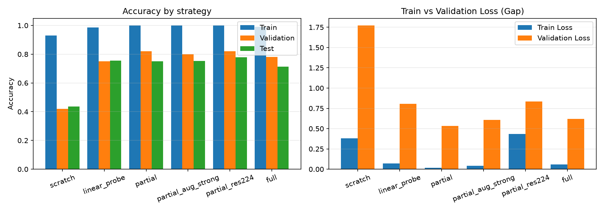
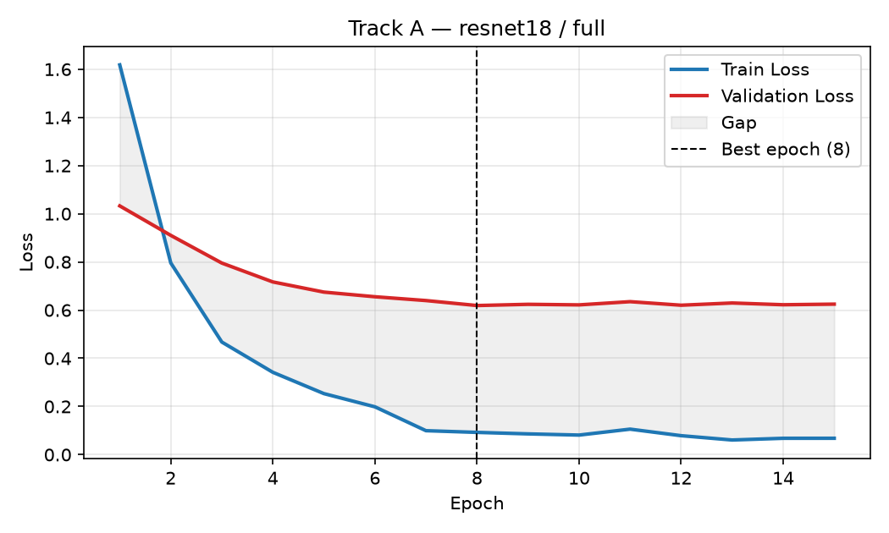
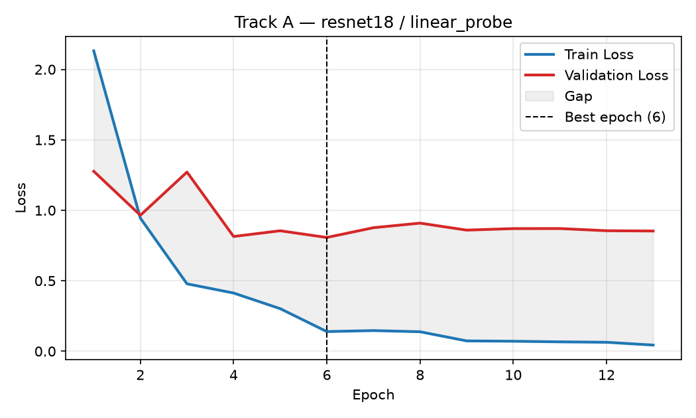
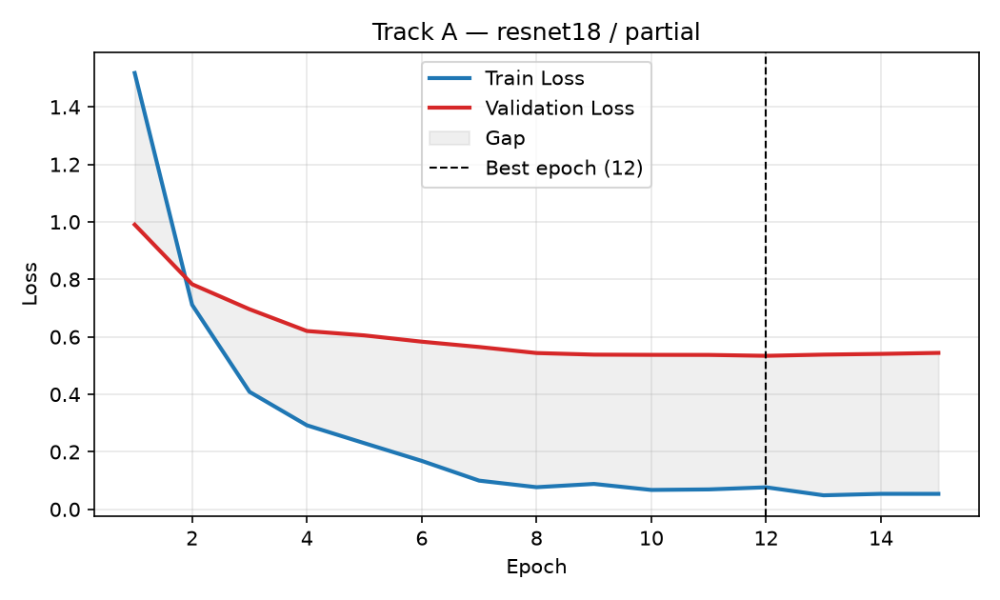
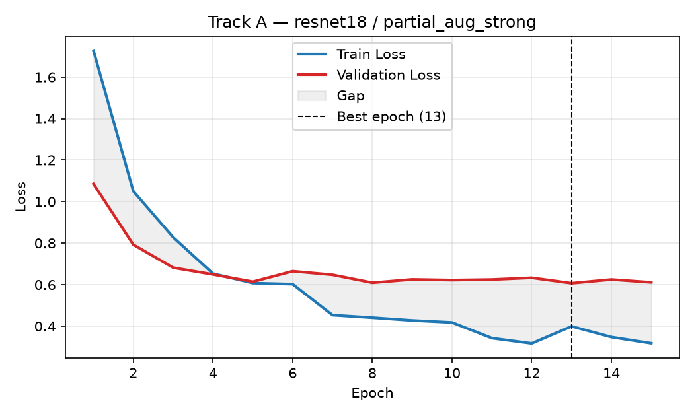
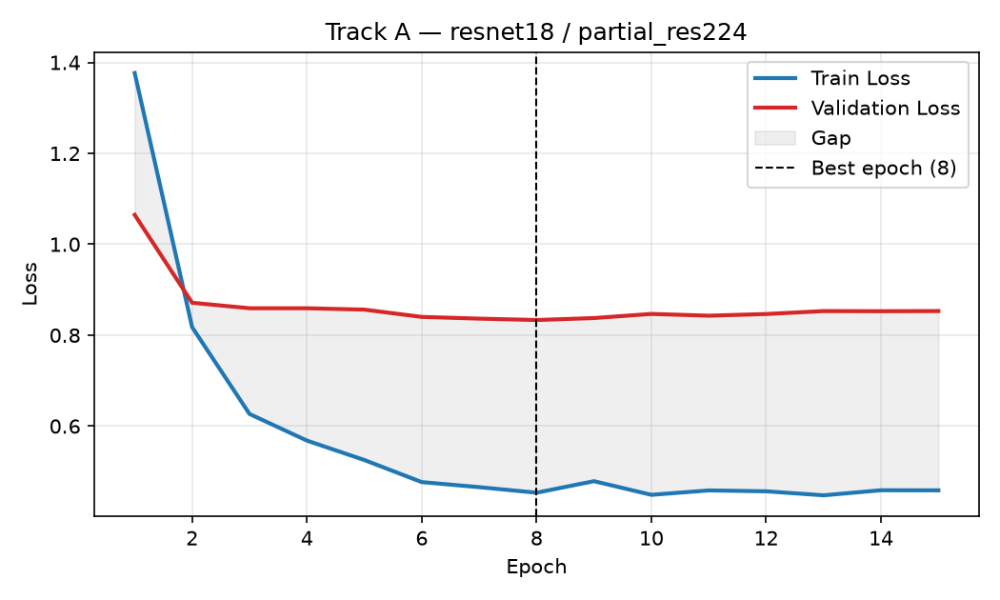
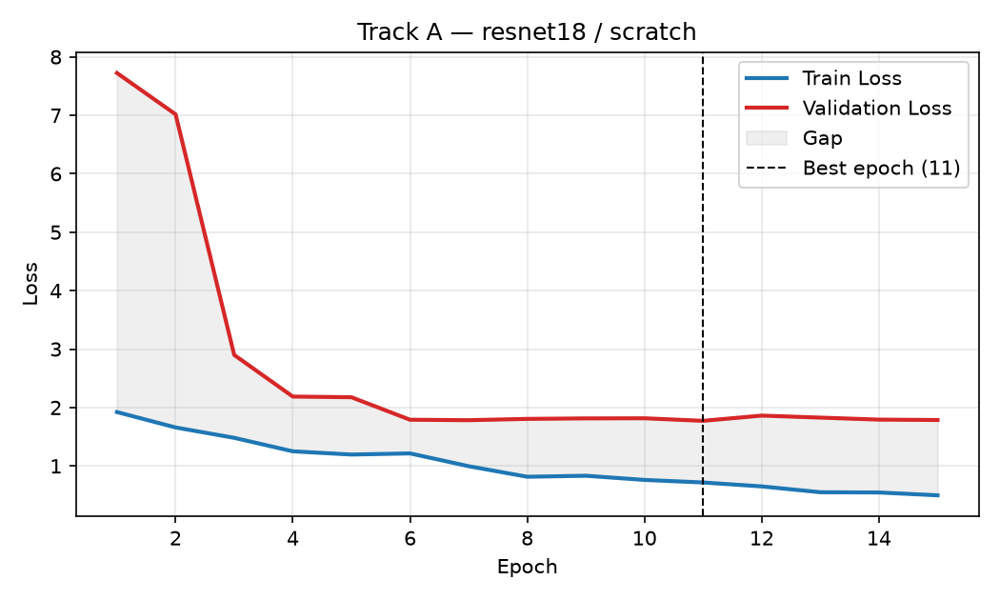

# Track A — 전이 학습 전략 비교 & 편향/분산 진단 (자동 생성)

> `python -m src.track_a.train` 실행 시 자동 갱신. 해석/결정은 `reports/DIAGNOSIS_REPORT.md`에 작성.

| Run | 학습 파라미터 | Train Loss | Validation Loss | Gap | Train Acc | Validation Acc | Test Acc | 오분류 | 진단 |
|---|---:|---:|---:|---:|---:|---:|---:|---:|---|
| scratch | 11,179,077 | 0.3812 | 1.7721 | +1.3909 | 0.930 | 0.420 | 0.436 | 282 | High Variance (Overfitting) |
| linear_probe | 2,565 | 0.0716 | 0.8071 | +0.7356 | 0.985 | 0.750 | 0.756 | 122 | High Variance (Overfitting) |
| partial | 8,396,293 | 0.0183 | 0.5341 | +0.5158 | 1.000 | 0.820 | 0.750 | 125 | High Variance (Overfitting) |
| partial_aug_strong | 8,396,293 | 0.0436 | 0.6070 | +0.5634 | 1.000 | 0.800 | 0.752 | 124 | High Variance (Overfitting) |
| partial_res224 | 8,396,293 | 0.4354 | 0.8334 | +0.3979 | 1.000 | 0.820 | 0.778 | 111 | High Variance (Overfitting) |
| full | 11,179,077 | 0.0580 | 0.6190 | +0.5610 | 0.990 | 0.780 | 0.714 | 143 | High Variance (Overfitting) |

## Run별 처방

- **full** — High Variance (Overfitting): 정규화(Dropout↑, Weight Decay/L2), 데이터 증강, Early Stopping, Freeze 범위↑, 데이터 추가.
- **linear_probe** — High Variance (Overfitting): 정규화(Dropout↑, Weight Decay/L2), 데이터 증강, Early Stopping, Freeze 범위↑, 데이터 추가.
- **partial** — High Variance (Overfitting): 정규화(Dropout↑, Weight Decay/L2), 데이터 증강, Early Stopping, Freeze 범위↑, 데이터 추가.
- **partial_aug_strong** — High Variance (Overfitting): 정규화(Dropout↑, Weight Decay/L2), 데이터 증강, Early Stopping, Freeze 범위↑, 데이터 추가.
- **partial_res224** — High Variance (Overfitting): 정규화(Dropout↑, Weight Decay/L2), 데이터 증강, Early Stopping, Freeze 범위↑, 데이터 추가.
- **scratch** — High Variance (Overfitting): 정규화(Dropout↑, Weight Decay/L2), 데이터 증강, Early Stopping, Freeze 범위↑, 데이터 추가.

