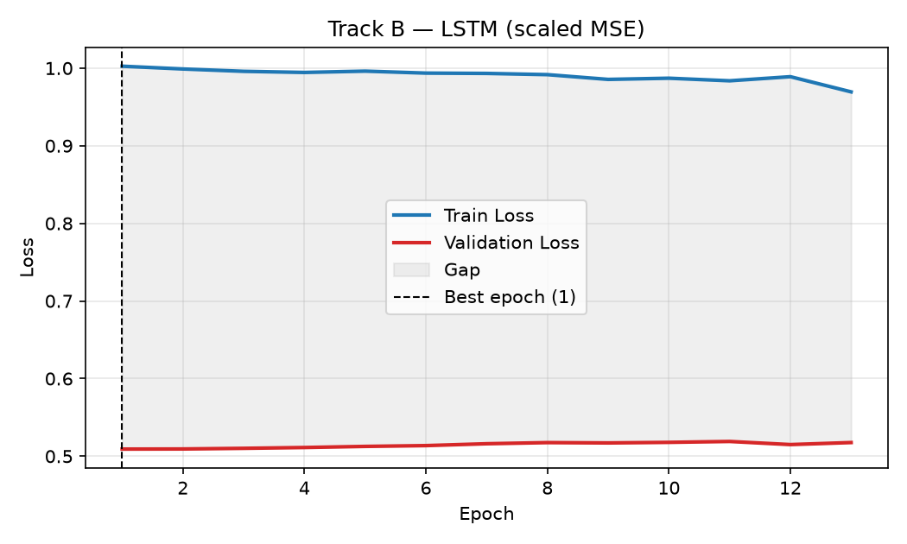
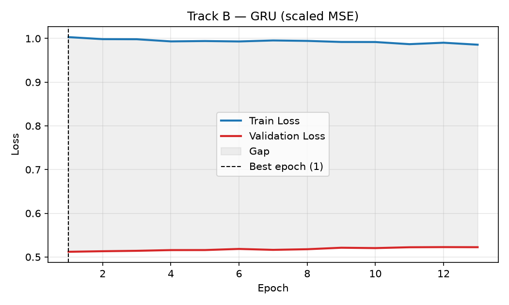
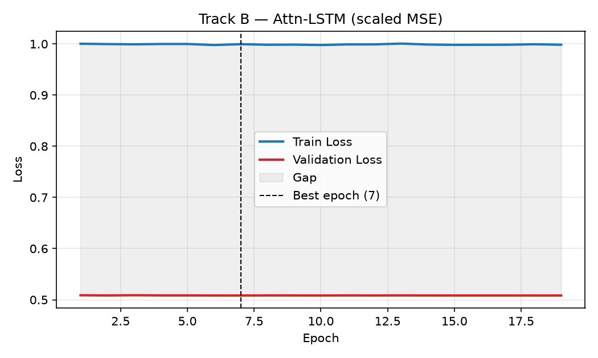

# Track B — 편향/분산 진단 (자동 생성)

- Loss = 스케일된 로그수익률의 MSE. 기준 Loss 1.0 = 'Train 평균 수익률만 예측'했을 때의 MSE (≈ 1 − R²).
- ⚠️ 금융 수익률은 Bayes error(예측 불가능한 잡음)가 매우 크다. rel_train≈1 이 나와도 '모델이 작아서'가 아니라 '신호 자체가 적어서'일 수 있다 → Naive 대비 개선 여부와 함께 해석할 것.

| Model     |   Train Loss |   Validation Loss |     Gap |   rel_train | state                    |   best_epoch |   epochs_ran |
|:----------|-------------:|------------------:|--------:|------------:|:-------------------------|-------------:|-------------:|
| LSTM      |       0.9969 |            0.5096 | -0.4873 |      0.9969 | High Bias (Underfitting) |            1 |           13 |
| GRU       |       0.9967 |            0.5119 | -0.4848 |      0.9967 | High Bias (Underfitting) |            1 |           13 |
| Attn-LSTM |       0.9979 |            0.5082 | -0.4897 |      0.9979 | High Bias (Underfitting) |            7 |           19 |

## 처방

- **LSTM** — High Bias (Underfitting): rel_train≈1이면 모델 용량 부족보다 Bayes error(예측 불가능한 잡음)일 가능성이 크다. 용량↑는 Validation Loss가 실제로 개선될 때만 채택하고, 우선 Naive 대비 성능·다변량 피쳐(거래량·지수)·타깃 재정의(방향 분류, 다중 시점)를 검토한다. Validation < Train 이면 구간별 변동성 차이를 먼저 확인.
- **GRU** — High Bias (Underfitting): rel_train≈1이면 모델 용량 부족보다 Bayes error(예측 불가능한 잡음)일 가능성이 크다. 용량↑는 Validation Loss가 실제로 개선될 때만 채택하고, 우선 Naive 대비 성능·다변량 피쳐(거래량·지수)·타깃 재정의(방향 분류, 다중 시점)를 검토한다. Validation < Train 이면 구간별 변동성 차이를 먼저 확인.
- **Attn-LSTM** — High Bias (Underfitting): rel_train≈1이면 모델 용량 부족보다 Bayes error(예측 불가능한 잡음)일 가능성이 크다. 용량↑는 Validation Loss가 실제로 개선될 때만 채택하고, 우선 Naive 대비 성능·다변량 피쳐(거래량·지수)·타깃 재정의(방향 분류, 다중 시점)를 검토한다. Validation < Train 이면 구간별 변동성 차이를 먼저 확인.

